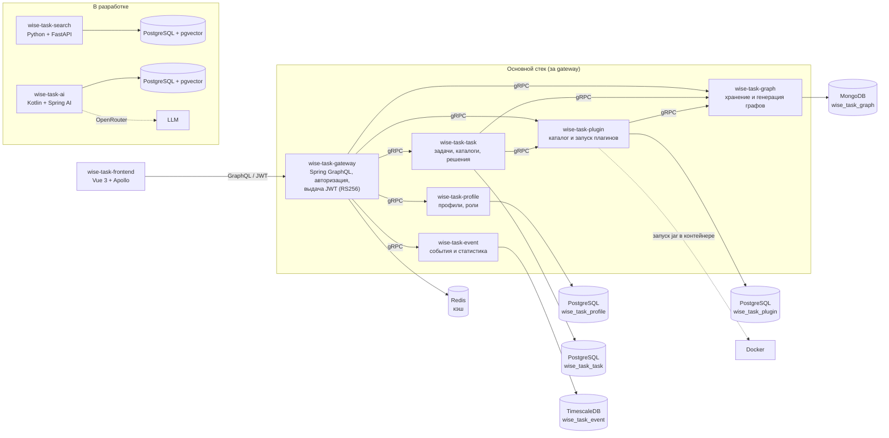

# WiseTask

**WiseTask** — учебная платформа по теории графов. Студенты решают задачи двух типов: **графовые** (построить граф, удовлетворяющий свойствам — связность, паросочетания, хроматическое число и т.д.) и **реализационные** (написать алгоритм кодом). Авторы создают задачи и плагины-проверки; проверка происходит автоматически: свойства графа вычисляют плагины, код — запускается в изолированном окружении.

## Архитектура

Единая точка входа — GraphQL-gateway, бизнес-логика разнесена по gRPC-микросервисам, каждый со своей БД.



Пунктирные стрелки — интеграционные (запуск внешних плагинов, LLM). MongoDB используется только через wise-task-graph. Внешние jar-плагины пользователей выполняются plugin-сервисом в одноразовых Docker-контейнерах без сети с лимитами ресурсов. wise-task-search индексирует данные через GraphQL gateway, wise-task-ai ходит в сервисы по gRPC — обе связи появятся на схеме по мере готовности сервисов.

Пайплайн проверки решения: студент отправляет решение → task-сервис сохраняет граф и для каждого условия задачи вызывает плагин → плагин (встроенный бин или пользовательский jar в отдельном Docker-контейнере с лимитами CPU/памяти/времени) вычисляет ответ → результат сверяется с ожидаемым и сохраняется.

## Репозитории

| Репозиторий | Назначение |
|---|---|
| [**wise-task-gateway**](https://github.com/wisetask/wise-task-gateway) | Единая точка входа: GraphQL API для фронтенда, JWT-авторизация (RS256), кэширование (Redis), роутинг в микросервисы. Здесь же общий `docker-compose` стенда с инфраструктурой (PostgreSQL, MongoDB, Redis, SMTP, Grafana/Loki/Prometheus/Tempo). |
| [**wise-task-frontend**](https://github.com/wisetask/wise-task-frontend) | SPA на Vue 3 + Apollo Client. Редактор графов на `vue-flow`, каталог задач, проверка решений. |
| [**wise-task-profile**](https://github.com/wisetask/wise-task-profile) | Профили пользователей и роли (`USER`/`AUTHOR`/`ADMIN`), регистрация, вход, смена/сброс пароля (BCrypt + SMTP). Выдаёт JWT gateway, этот сервис проверяет учётные данные. БД — PostgreSQL, схема в Liquibase. |
| [**wise-task-task**](https://github.com/wisetask/wise-task-task) | Задачи (графовые и реализационные), каталоги задач, решения студентов и конвейер проверки. БД — PostgreSQL. |
| [**wise-task-plugin**](https://github.com/wisetask/wise-task-plugin) | Библиотека плагинов над графами: ~80 встроенных алгоритмов теории графов + внешние jar пользователей. Внешние плагины выполняются в изолированных Docker-контейнерах с ограничениями ресурсов. |
| [**wise-task-graph**](https://github.com/wisetask/wise-task-graph) | Хранение графов, генерация случайных графов, поиск по фильтрам. БД — MongoDB (реактивный стек). |
| [**wise-task-event**](https://github.com/wisetask/wise-task-event) | Сервис событий и статистики: действия пользователей (просмотр задачи, решение и т.д.), агрегаты — успешность задач, активность. БД — PostgreSQL + TimescaleDB. |
| [**wise-task-search**](https://github.com/wisetask/wise-task-search) | Векторный (семантический) поиск по задачам и плагинам: эмбеддинги `BAAI/bge-m3`, PostgreSQL + pgvector (HNSW). Python + FastAPI. В разработке; отдельный сервис вне gateway — индексирует данные через его GraphQL API. |
| [**wise-task-ai**](https://github.com/wisetask/wise-task-ai) | Чат-бот с тулами для сервисов WiseTask: Kotlin + Spring AI (OpenRouter, RAG), gRPC-тулы к profile/task/plugin/event, своё хранилище PostgreSQL + pgvector. В разработке; отдельный сервис вне gateway. |
| [**wise-task-library**](https://github.com/wisetask/wise-task-library) | Общая библиотека: модели графа (`Graph`/`Vertex`/`Edge`), интерфейсы плагинов (`GraphProperty`, `GraphCharacteristic`, ...), утилиты JSON-сериализации. Публикуется через JitPack. |

Также в экосистеме: **Runner** — маленький Java-загрузчик, который выполняется внутри контейнера при проверке внешних плагинов: грузит jar пользователя через `URLClassLoader`, десериализует граф из JSON и вызывает плагин.

## Технологии

- **Backend**: Java 25, Spring Boot 4.x, gRPC (spring-grpc), MapStruct, Liquibase
- **Поиск**: Python, FastAPI, sentence-transformers (bge-m3), pgvector
- **AI**: Kotlin, Spring AI (OpenAI, RAG, pgvector)
- **Frontend**: Vue 3, Apollo Client, vue-flow, Vite, Bun
- **Данные**: PostgreSQL, MongoDB, Redis, pgvector, TimescaleDB
- **Инфраструктура**: Docker Compose, GitHub Actions (сборка и публикация образов)
- **Наблюдаемость**: Grafana, Prometheus, Loki (логи), Tempo (трейсы OpenTelemetry)

## Стек взаимодействия

```
Frontend ──HTTP GraphQL──> Gateway ──gRPC──> Микросервисы ──> Своё хранилище у каждого
```

- Для фронтенда весь мир — один GraphQL-эндпоинт со схемой из `gateway/src/main/resources/graphql`.
- Между сервисами — только gRPC (protos хранятся в `src/main/resources/proto` каждого сервиса).
- Внешние плагины пользователей — jar-файлы, выполняются в одноразовых контейнерах без сети с лимитами ресурсов.

## Начало работы

```bash
git clone https://github.com/wisetask/wise-task-gateway.git
cd wise-task-gateway
cp example.env .env
docker compose up -d --build
```

Стенд поднимет все сервисы + инфраструктуру. GraphQL IDE: `http://localhost:8084/graphiql`, Grafana: `http://localhost:3000`.

Подробнее о каждом сервисе — в README соответствующего репозитория.
